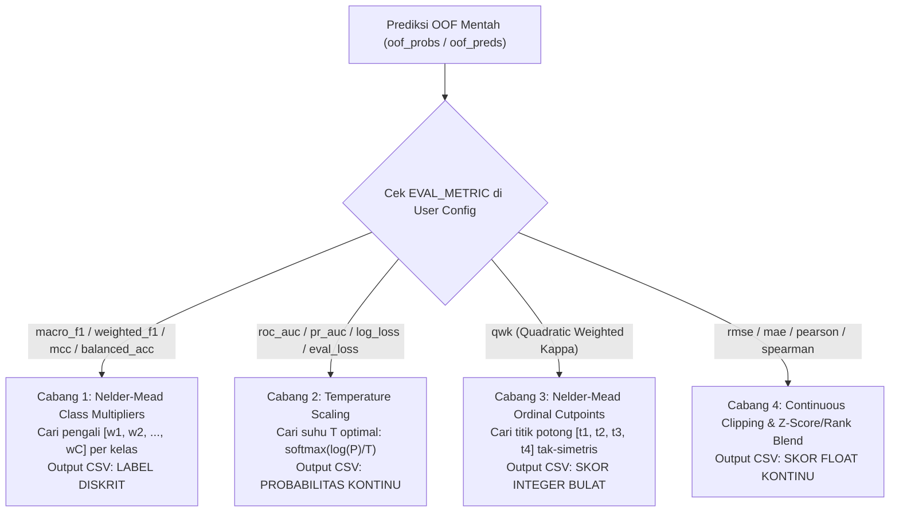

# 🎯 03. Mekanisme Post-Processing, Nelder-Mead Optimizer, & Auto-Switch Submission
## Bagaimana Kit Ini Mendongkrak Skor +0.01 s/d +0.04 Tanpa Melatih Ulang Model?

Banyak peserta lomba langsung mengambil `np.argmax(probs)` atau membulatkan skor regresi dengan `np.round(preds)` begitu training selesai. Padahal, **probabilitas mentah (*Out-Of-Fold / OOF predictions*) menyimpan potensi kenaikan skor yang besar** jika dikalibrasi sesuai rumus metrik lomba (`EVAL_METRIC`).

---

## 1. Tiga Cabang Otomatis `OPTIMIZE_THRESHOLDS = True` Berdasarkan `EVAL_METRIC`

Di dalam modul [`smart_loader.py`](file:///c:/Users/yasse/OneDrive/Desktop/Mine%20All%20Ds/kitGemastikk/NLP-FULL%20KIT/00_QUICK_START/smart_loader.py), fungsi `optimize_classification_oof()` dan post-processing regresi secara otomatis memilih algoritma kalibrasi yang tepat:

---

### Cabang 1: Nelder-Mead Class Multipliers (`macro_f1`, `mcc`, `balanced_accuracy`)
- **Masalah:** Pada dataset *imbalanced* (misal Kelas 0: 70%, Kelas 1: 25%, Kelas 2: 5%), model cenderung mengeluarkan probabilitas rata-rata yang kecil untuk Kelas 2 (misal `[0.42, 0.38, 0.20]`). Jika memakai `argmax` biasa, Kelas 2 kalah terus meskipun probabilitas `0.20` itu sebenarnya sudah sangat tinggi untuk ukuran kelas 5%!
- **Cara Kerja di Kit:** Algoritma *Nelder-Mead Simplex* mencari vektor pengali $\mathbf{w} = [w_0, w_1, w_2]$ pada prediksi OOF (misal ditemukan $\mathbf{w} = [0.85, 1.02, 2.30]$).
  Setelah dikalikan:
  $$[0.42 \times 0.85, \; 0.38 \times 1.02, \; 0.20 \times 2.30] = [0.357, \; 0.387, \; \mathbf{0.460}] \longrightarrow \text{Tebakan berubah menjadi Kelas 2!}$$
- Pengali optimal $\mathbf{w}^*$ yang ditemukan di OOF ini kemudian langsung diterapkan pada `test_probs` untuk menghasilkan `submission_*_postprocessed.csv`.

---

### Cabang 2: Temperature Scaling & Auto-Proba (`roc_auc`, `pr_auc`, `log_loss`)
- **Masalah:** Jika panitia menilai menggunakan `roc_auc` atau `log_loss`, mengirim label bulat `0` dan `1` adalah kesalahan fatal. Selain itu, hasil gabungan beberapa model sering memiliki tingkat keyakinan (*entropy*) yang kurang pas untuk `log_loss`.
- **Cara Kerja di Kit:**
  1. Mencari parameter suhu tunggal $T > 0$ yang meminimalkan `log_loss` pada OOF:
     $$P_{\text{calibrated}}(y=c|x) = \frac{P(y=c|x)^{1/T}}{\sum_k P(y=k|x)^{1/T}}$$
  2. Mengubah `SUBMISSION_OUTPUT_TYPE` secara otomatis menjadi **`'proba'`** sehingga file submission berisi nilai probabilitas terkalibrasi.

---

### Cabang 3: Nelder-Mead Ordinal Threshold Cutter (`qwk` pada Regresi Esai)
- **Masalah:** Model regresi memprediksi skor kontinu (misal $1.00 \text{ s/d } 5.00$), sedangkan label asli esai adalah bilangan bulat $\{1, 2, 3, 4, 5\}$. Pembulatan standar (`np.round`) memotong kaku di titik $[1.50, 2.50, 3.50, 4.50]$. Padahal, prediksi model regresi selalu menyempit ke arah nilai rata-rata (*regression to the mean*), sehingga skor 1 dan 5 jarang tercapai jika titik potongnya di $1.50$ dan $4.50$!
- **Cara Kerja di Kit:** Nelder-Mead menggeser keempat titik potong tersebut secara bebas di atas OOF untuk memaksimalkan rumus `cohen_kappa_score(..., weights='quadratic')`, misalnya menemukan titik potong optimal:
  $$\mathbf{t}^* = [1.82, \; 2.61, \; 3.44, \; 4.18]$$
  Dengan titik potong ini, prediksi $4.25$ (yang tadinya dibulatkan jadi $4$) kini berhasil masuk ke **Skor 5**, mendongkrak skor QWK hingga $+0.02\text{--}0.04$ poin!

