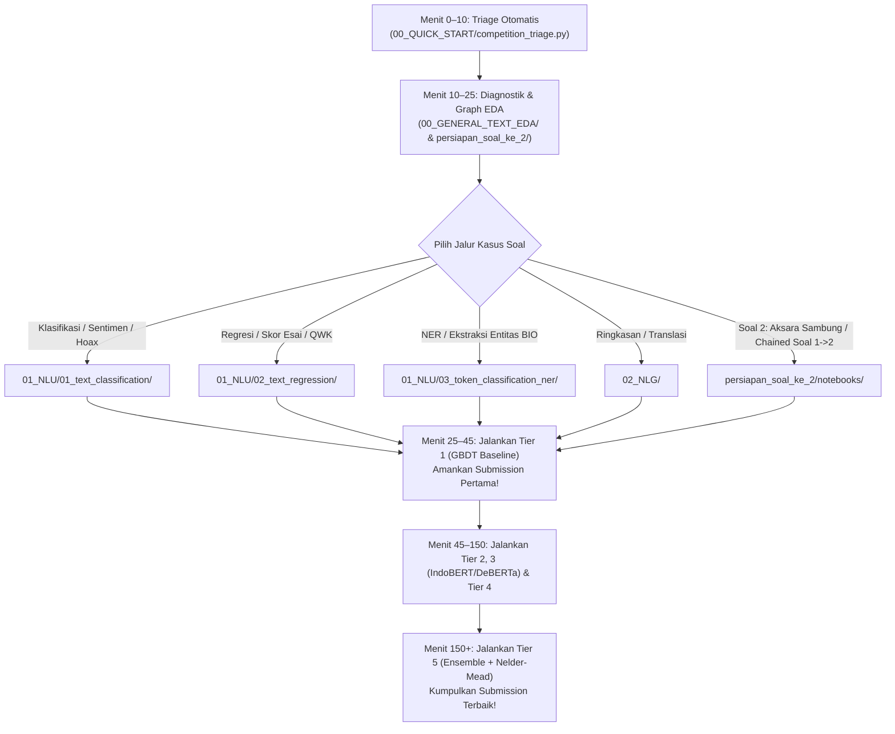

# 🏆 NLP Competition Full Kit — Panduan & Penjelasan Struktur Lengkap

> **Standar Kompetisi:** GEMASTIK XIX 2026 (Data Mining), SATRIA DATA, & Kaggle NLP Championship  
> **Target Perangkat Keras:** Kompatibel penuh dengan **NVIDIA RTX 3050 Laptop GPU (4GB VRAM)** & CPU-Only  
> **Jaminan Kualitas:** 100% Notebook *Pre-Executed* (Output & Grafik Tersimpan), Bebas `assert`, Standar Output Bersih (`models/`), & 100% Siap Offline (*Air-Gapped*).

---

## 🗺️ 1. Peta Arsitektur Direktori Utama (`NLP-FULL KIT`)

Seluruh kit ini dirancang secara modular menjadi **8 area utama** berdasarkan alur kerja lomba dari menit pertama membuka soal hingga pengumpulan *submission* terakhir dan presentasi babak final:

```text
NLP-FULL KIT/
│
├── 📁 00_QUICK_START/                          # ⚡ Pintu Masuk Utama, Triage Otomatis & Engine Universal
│   ├── competition_triage.py                  # CLI deteksi otomatis tipe kasus, kolom, & generator User Config
│   ├── verify_environment.py                  # Audit kesiapan GPU CUDA, VRAM, & versi library
│   ├── SOP_5_JAM_GEMASTIK.md                  # Rencana taktis menit-demi-menit untuk lomba 5 jam (Onsite/Penyisihan)
│   ├── smart_loader.py                        # Engine pembaca 8+ format data + 20 Loss + 38 Metrik + Checkpoint Monitor
│   └── indonesian_regex_combinator.py         # Engine 7 Lego Bricks normalisasi & ekstraksi sinyal Regex Bahasa Indonesia
│
├── 📁 00_USER_CONFIG_DEEP_DIVE/                # 🧠 Dokumentasi Konsep Mendalam & "Tombol Panik" Saat Lomba
│   ├── 00_PANIC_BUTTON_SAFE_DEFAULTS.md       # 🚨 CONTEKAN DARURAT: Settingan paling aman jika bingung/panik saat onsite!
│   ├── 01_LOSS_VS_METRIC_VS_CHECKPOINT_MONITOR.md  # Bedah tuntas perbedaan LOSS_FUNCTION, EVAL_METRIC & CHECKPOINT_MONITOR
│   ├── 02_ADVANCED_HYPERPARAMETERS_AND_VRAM_MATH.md # Matematika VRAM O(L^2), Head+Tail Truncation, Grad Accum, Focal/PolyLoss
│   ├── 03_POSTPROCESSING_AND_NELDER_MEAD_MECHANICS.md # Cara kerja Nelder-Mead Multiplier, Temperature Scaling & QWK Cutpoints
│   └── README.md                              # Daftar isi panduan konsep konfigurasi tingkat lanjut
│
├── 📁 00_GENERAL_TEXT_EDA/                    # 🔬 Suite Diagnostik Teks Universal (Dipakai di Awal Semua Soal)
│   ├── 01_token_length_and_truncation.ipynb   # Distribusi panjang kata/token, kurva CDF, & penentuan MAX_LENGTH
│   ├── 02_vocabulary_and_oov_overlap.ipynb    # Analisis irisan kosakata Train vs Test & risiko Out-Of-Vocabulary (OOV)
│   ├── 03_text_noise_and_cleaning.ipynb       # Pemindai HTML, emoji, URL, tanda baca ekstrem, & karakter rusak
│   ├── 04_group_leakage_and_duplicates.ipynb  # Deteksi duplikat MD5, near-duplicate, & kebocoran grup (GroupKFold)
│   ├── 03_network_graph_representation_eda.ipynb      # Visualisasi Word Co-occurrence Network (PageRank) & k-NN Homophily
│   ├── 04_indonesian_regex_combinator_pipeline.ipynb  # Eksperimen & visualisasi 7 Lego Bricks Regex Bahasa Indonesia
│   └── README.md                              # Matriks keputusan dari temuan EDA -> parameter User Config
│
├── 📁 01_NLU/                                  # 🧠 Natural Language Understanding (Tugas Diskriminatif & Sekuens)
│   │
│   ├── 📁 01_text_classification/             # 🎯 Klasifikasi Teks (Binary, Multiclass, Multilabel, Sentimen, Hoax, Emosi)
│   │   ├── demo_data/                         # Dataset sintetis terverifikasi (train, test, sample_submission)
│   │   ├── eda/                               # EDA khusus klasifikasi (distribusi kelas, rasio timpang, N-gram per kelas)
│   │   ├── notebooks/                         # 5-Tier Pipeline Lengkap + folder models/ (.pth, .txt, .json)
│   │   └── modular_variations/                # Potongan kode Lego Bricks siap tempel (Slang, Focal Loss, Thresholds)
│   │
│   ├── 📁 02_text_regression/                 # 🎯 Regresi Teks, Automated Essay Scoring (AES), Rating & QWK
│   │   ├── demo_data/                         # Dataset esai & skor kontinu/ordinal
│   │   ├── eda/                               # EDA khusus regresi (skewness, kurtosis, korelasi keterbacaan/panjang)
│   │   ├── notebooks/                         # 5-Tier Pipeline Lengkap + Optimasi QWK Nelder-Mead Cutpoints
│   │   ├── modular_variations/                # Lego Bricks fitur keterbacaan (readability) & QWK cutter
│   │   └── switchboard/                       # Modul dispatcher regresi & QWK
│   │
│   └── 📁 03_token_classification_ner/        # 🎯 Named Entity Recognition (NER), BIO Tagging & Ekstraksi Span
│       ├── demo_data/                         # Dataset sekuens token berlabel BIO (B-LOC, I-LOC, B-PER, O, dll.)
│       ├── eda/                               # EDA transisi tag BIO, panjang entitas, & rasio token 'O'
│       ├── notebooks/                         # 3-Tier Pipeline (BiLSTM-CRF Viterbi -> Transformer NER -> Ensemble BIO)
│       └── modular_variations/                # Subword BIO alignment, Masked/Focal Token Loss, & BIO Sequence Repair
│
├── 📁 02_NLG/                                  # ✍️ Natural Language Generation (Tugas Generatif & Teks-ke-Teks)
│   │
│   ├── 📁 01_text_summarization/              # 🎯 Peringkasan Dokumen (Extractive TextRank/Lead-K & Abstractive Seq2Seq)
│   │   ├── demo_data/                         # Pasangan artikel panjang & ringkasan target
│   │   ├── eda/                               # EDA rasio kompresi, persentase kata baru (novelty), & posisi kalimat kunci
│   │   ├── notebooks/                         # 2-Tier Pipeline (Extractive TextRank/LexRank -> Neural Seq2Seq Summarizer)
│   │   └── modular_variations/                # Lead-3 extractor, Beam search tuner, & Trigram repetition cleaner
│   │
│   └── 📁 02_machine_translation_and_rewriting/ # 🎯 Translasi Bahasa Daerah/Asing, Restorasi OCR/Aksara & Prompt Recovery
│       ├── demo_data/                         # Pasangan kalimat paralel (Sumber <-> Target)
│       ├── eda/                               # EDA rasio panjang kalimat paralel & overlap karakter/subword
│       ├── notebooks/                         # 2-Tier Pipeline (Seq2Seq + Kamus Lexicon Override -> Cosine Prompt Recovery)
│       └── modular_variations/                # Filter panjang paralel, Label Smoothing NLL, & Fallback cleaner
│
├── 📁 persiapan_soal_ke_2/                     # 🚀 Senjata Taktis Soal ke-2 GEMASTIK, Network Graph & Regex Indonesia
│   ├── indonesian_regex_combinator.py         # Modul utama 7 Lego Bricks Regex Bahasa Indonesia + 13 fitur sinyal pra-bersih
│   ├── demo_data/                             # Dataset simulasi Sambungan Aksara Tanpa Spasi & Chained Context Soal 1->2
│   ├── notebooks/                             # 4 Notebook Spesialis Soal 2, Network Graph EDA, & Regex Indonesia
│   │   ├── 01_soal2_sambungan_aksara_dan_makna.ipynb      # Viterbi DP + PyTorch Char-BiLSTM Segmenter + Translasi Makna
│   │   ├── 02_soal2_chained_context_predictor.ipynb       # Prediksi Berantai Soal 1 -> Soal 2 (Context Prefix + Prob Stacking)
│   │   ├── 03_network_graph_representation_eda.ipynb      # Word Co-occurrence Network (PageRank) & k-NN Document Homophily
│   │   └── 04_indonesian_regex_combinator_pipeline.ipynb  # Ablasi & visualisasi 7 Lego Bricks Regex Bahasa Indonesia
│   └── README.md                              # Panduan taktis menghadapi Soal ke-2 GEMASTIK
│
├── 📁 03_OFFLINE_WEIGHTS/                     # 💾 Gudang Bobot Model Pretrained Lokal (100% Tanpa Internet)
│   ├── download_weights.py                    # Skrip pengunduh model HuggingFace ke folder lokal
│   ├── weights/                               # Berisi 5 model siap pakai:
│   │   ├── indobert-base/                     # -> Senjata utama teks Bahasa Indonesia (indobenchmark/indobert-base-p1)
│   │   ├── deberta-v3-small/                  # -> Senjata utama teks Bahasa Inggris & Essay Scoring (microsoft/deberta-v3-small)
│   │   ├── distilbert-multilingual/           # -> Cepat & ringan untuk multi-bahasa / kode campuran
│   │   ├── distilbert-uncased/                # -> Cepat & ringan untuk Bahasa Inggris
│   │   └── xlm-roberta-base/                  # -> Kuat untuk lintas bahasa & Bahasa Daerah Nusantara
│   └── README.md                              # Cara mengarahkan MODEL_CHECKPOINT ke folder lokal saat offline
│
├── 📁 04_LEGACY_CASES_ARCHIVE/                # 📦 Arsip 12 Studi Kasus Spesifik (Referensi Tambahan)
├── UNIFIED_COMPETITION_FRAMEWORK_GUIDE.md     # 📜 Standar Arsitektur & Kode Bersih Kompetisi Data Science
├── nlp_kaggle_cases.md                        # 🗺️ Ensiklopedia Taksonomi Kasus-Kasus NLP Kaggle & GEMASTIK
└── profil_penyusun_gemastik2026_datamining.md # 🕵️ Analisis Riset Juri/Penyusun Soal GEMASTIK Data Mining 2026
```

---

## 🔍 2. Penjelasan Detail Setiap Folder & Komponennya

### ⚡ A. [`00_QUICK_START/`](file:///c:/Users/yasse/OneDrive/Desktop/Mine%20All%20Ds/kitGemastikk/NLP-FULL%20KIT/00_QUICK_START/) — Pintu Masuk & Mesin Utama
Folder ini berisi skrip pembuka lomba dan modul inti yang di-import oleh seluruh notebook:
1. **[`competition_triage.py`](file:///c:/Users/yasse/OneDrive/Desktop/Mine%20All%20Ds/kitGemastikk/NLP-FULL%20KIT/00_QUICK_START/competition_triage.py):** Jalankan lewat terminal begitu menerima dataset baru. Skrip ini otomatis mendeteksi tipe tugas (Klasifikasi, Regresi, NER, atau NLG), mengenali kolom ID/Teks/Target, dan mencetak blok **Master User Configuration** yang tinggal di-*copy-paste*.
2. **[`smart_loader.py`](file:///c:/Users/yasse/OneDrive/Desktop/Mine%20All%20Ds/kitGemastikk/NLP-FULL%20KIT/00_QUICK_START/smart_loader.py):** Mesin serbaguna yang menangani 4 hal krusial:
   - **Multi-Format Data Ingestion (`load_raw_format_to_df`):** Membaca `.csv`, `.tsv`, `.json` (flat, nested `{"data": [...]}`, maupun dict-of-dicts), `.jsonl`, `.parquet`, `.xlsx`, `.conll`/`.bio` (NER), hingga folder berisi ribuan file `.txt` (`TRAIN_TEXT_DIR` / `TEST_TEXT_DIR`).
   - **Head+Tail Smart Truncation:** Memotong dokumen super panjang dengan mempertahankan bagian awal (*Head*) dan kesimpulan akhir (*Tail*) agar tidak kehilangan kalimat kunci.
   - **20 Variasi `LOSS_FUNCTION` (`UniversalPyTorchLossCriterion`):** Mendukung `'auto'`, `'cross_entropy'`, `'weighted_ce'`, `'focal_loss'`, `'poly1_ce'`, `'label_smoothing_ce'`, `'soft_f1_loss'`, `'combo_ce_f1'`, `'bce_logits'`, `'asymmetric_loss'`, `'smooth_l1'`, `'mse'`, `'mae'`, `'pearson_loss'`, `'rmsle_loss'`, `'crf_nll'`, `'masked_ce'`, `'token_focal_loss'`, `'label_smoothed_nll'`, dan `'cosine_embedding_loss'`.
   - **38 Metrik Evaluasi & Switchboard Otomatis:** Mencetak rapor lengkap seluruh metrik validasi sekaligus (`macro_f1`, `mcc`, `roc_auc`, `qwk`, `rmse`, `seqeval_f1`, `rouge1`, `bleu`, `chrf`, `cer`, `wer`, dll.) dan otomatis memilih teknik *post-processing* terbaik.
3. **[`SOP_5_JAM_GEMASTIK.md`](file:///c:/Users/yasse/OneDrive/Desktop/Mine%20All%20Ds/kitGemastikk/NLP-FULL%20KIT/00_QUICK_START/SOP_5_JAM_GEMASTIK.md):** Jadwal manajemen waktu selama 5 jam lomba agar tim tidak kehabisan waktu saat *training* model berat.

---

### 🧠 B. [`00_USER_CONFIG_DEEP_DIVE/`](file:///c:/Users/yasse/OneDrive/Desktop/Mine%20All%20Ds/kitGemastikk/NLP-FULL%20KIT/00_USER_CONFIG_DEEP_DIVE/README.md) — Dokumentasi Konsep & Tombol Panik
Dibuat khusus di luar `01_NLU` dan `02_NLG` agar anggota tim bisa memahami parameter konfigurasi yang rumit tanpa kebingungan:
- **[`00_PANIC_BUTTON_SAFE_DEFAULTS.md`](file:///c:/Users/yasse/OneDrive/Desktop/Mine%20All%20Ds/kitGemastikk/NLP-FULL%20KIT/00_USER_CONFIG_DEEP_DIVE/00_PANIC_BUTTON_SAFE_DEFAULTS.md):** **Wajib dibuka saat panik/ragu di lokasi lomba!** Berisi kombinasi parameter paling aman dan general (`LOSS_FUNCTION='auto'`, `CHECKPOINT_MONITOR='hybrid'`, `TRUNCATION_SIDE='head_tail'`) yang dijamin stabil untuk semua kasus.
- **[`01_LOSS_VS_METRIC_VS_CHECKPOINT_MONITOR.md`](file:///c:/Users/yasse/OneDrive/Desktop/Mine%20All%20Ds/kitGemastikk/NLP-FULL%20KIT/00_USER_CONFIG_DEEP_DIVE/01_LOSS_VS_METRIC_VS_CHECKPOINT_MONITOR.md):** Penjelasan lengkap perbedaan antara **Loss Function** (kompas gradien saat *backpropagation*), **Eval Metric** (skor papan peringkat juri), dan **Checkpoint Monitor** (penjaga gawang penyimpan model `.pth` terbaik), termasuk cara memakai `'soft_f1_loss'` dan `'combo_ce_f1'`.
- **[`02_ADVANCED_HYPERPARAMETERS_AND_VRAM_MATH.md`](file:///c:/Users/yasse/OneDrive/Desktop/Mine%20All%20Ds/kitGemastikk/NLP-FULL%20KIT/00_USER_CONFIG_DEEP_DIVE/02_ADVANCED_HYPERPARAMETERS_AND_VRAM_MATH.md):** Rumus kuadratik memori $\mathcal{O}(L^2)$ pada Transformer, alasan `BATCH_SIZE=8` + `GRAD_ACCUM_STEPS=2` menyelamatkan GPU 4GB dari *CUDA Out of Memory*, serta kapan memilih `StratifiedKFold` vs `GroupKFold`.
- **[`03_POSTPROCESSING_AND_NELDER_MEAD_MECHANICS.md`](file:///c:/Users/yasse/OneDrive/Desktop/Mine%20All%20Ds/kitGemastikk/NLP-FULL%20KIT/00_USER_CONFIG_DEEP_DIVE/03_POSTPROCESSING_AND_NELDER_MEAD_MECHANICS.md):** Cara kerja algoritma optimasi **Nelder-Mead** dalam menggeser pengali probabilitas kelas (*Class Multipliers*) dan memotong batas skor esai (*QWK Cutpoints*) untuk menaikkan skor +1% hingga +4% tanpa *training* ulang.

---

### 🔬 C. [`00_GENERAL_TEXT_EDA/`](file:///c:/Users/yasse/OneDrive/Desktop/Mine%20All%20Ds/kitGemastikk/NLP-FULL%20KIT/00_GENERAL_TEXT_EDA/README.md) — Diagnostik Teks Universal
Berisi **6 notebook diagnostik** yang bisa dijalankan pada dataset teks apa pun sebelum masuk ke pemodelan:
1. **[`01_token_length_and_truncation.ipynb`](file:///c:/Users/yasse/OneDrive/Desktop/Mine%20All%20Ds/kitGemastikk/NLP-FULL%20KIT/00_GENERAL_TEXT_EDA/01_token_length_and_truncation.ipynb):** Menghitung persentil ke-95 dan ke-99 panjang teks untuk menentukan nilai `MAX_LENGTH` yang optimal dan hemat VRAM.
2. **[`02_vocabulary_and_oov_overlap.ipynb`](file:///c:/Users/yasse/OneDrive/Desktop/Mine%20All%20Ds/kitGemastikk/NLP-FULL%20KIT/00_GENERAL_TEXT_EDA/02_vocabulary_and_oov_overlap.ipynb):** Mengukur berapa persen kata di `test.csv` yang belum pernah muncul di `train.csv` (OOV) untuk menentukan apakah perlu memakai Char N-gram / FastText / Subword Transformer.
3. **[`03_text_noise_and_cleaning.ipynb`](file:///c:/Users/yasse/OneDrive/Desktop/Mine%20All%20Ds/kitGemastikk/NLP-FULL%20KIT/00_GENERAL_TEXT_EDA/03_text_noise_and_cleaning.ipynb):** Memindai persentase kotoran teks (HTML, URL, `@mention`, emoji, angka, huruf kapital berlebih).
4. **[`04_group_leakage_and_duplicates.ipynb`](file:///c:/Users/yasse/OneDrive/Desktop/Mine%20All%20Ds/kitGemastikk/NLP-FULL%20KIT/00_GENERAL_TEXT_EDA/04_group_leakage_and_duplicates.ipynb):** Mendeteksi baris teks yang kembar identik namun berbeda label (*noisy labels*) serta mengecek apakah wajib memakai `GroupKFold`.
5. **[`03_network_graph_representation_eda.ipynb`](file:///c:/Users/yasse/OneDrive/Desktop/Mine%20All%20Ds/kitGemastikk/NLP-FULL%20KIT/00_GENERAL_TEXT_EDA/03_network_graph_representation_eda.ipynb):** Memvisualisasikan jejaring ko-okurensi kata (*PageRank Hub Words*) & kemiripan antar-dokumen ($k$-NN Homophily).
6. **[`04_indonesian_regex_combinator_pipeline.ipynb`](file:///c:/Users/yasse/OneDrive/Desktop/Mine%20All%20Ds/kitGemastikk/NLP-FULL%20KIT/00_GENERAL_TEXT_EDA/04_indonesian_regex_combinator_pipeline.ipynb):** Menguji dan memvisualisasikan 13 sinyal Regex Bahasa Indonesia terhadap label target.

---

### 🧠 D. [`01_NLU/`](file:///c:/Users/yasse/OneDrive/Desktop/Mine%20All%20Ds/kitGemastikk/NLP-FULL%20KIT/01_NLU/) — Natural Language Understanding (3 Sub-Kit, 5 Tier Arsitektur)

Di dalam [`01_text_classification/`](file:///c:/Users/yasse/OneDrive/Desktop/Mine%20All%20Ds/kitGemastikk/NLP-FULL%20KIT/01_NLU/01_text_classification/README.md) dan [`02_text_regression/`](file:///c:/Users/yasse/OneDrive/Desktop/Mine%20All%20Ds/kitGemastikk/NLP-FULL%20KIT/01_NLU/02_text_regression/README.md), tersedia **5 Tier Notebook Berjenjang** dari yang paling cepat (CPU 30 detik) hingga yang paling akurat (Deep Transformer + Ensemble):

| Urutan Notebook | Nama Arsitektur (5 Tier) | Keunggulan Utama & Kapan Digunakan | Output Model di `notebooks/models/` |
| :--- | :--- | :--- | :--- |
| **Tier 1** (`01_sparse_dense_classical_ml.ipynb`) | **TF-IDF (Word + Char N-Gram) + SVD/LSA + FastText + Meta Features $\to$ LightGBM / Ridge** | **Baseline Tercepat (<1 menit di CPU)!** Wajib dijalankan pertama kali untuk mengamankan *Submission #1* di papan peringkat. | `lgb_fold*.txt` + `01_sparse_dense_config_results.json` |
| **Tier 2** (`02_dl_bilstm_gru_cnn_attention.ipynb`) | **PyTorch Scratch Multi-Branch: BiLSTM + BiGRU + 1D-CNN + Multi-Head AttentionPooling** | Jaringan saraf ringan dari nol tanpa ketergantungan bobot luar; menangkap pola lokal (CNN) & urutan (BiLSTM) dengan sangat cepat. | `best_dl_fold*.pth` + `02_dl_bilstm_config_results.json` |
| **Tier 3** (`03_pretrained_transformer_finetune.ipynb`) | **Fine-Tuned Pretrained Transformer (IndoBERT / DeBERTa-v3 / XLM-R) + MeanMax Pooler + FP16 + Grad Accum** | **Skor Tunggal Tertinggi!** Memahami konteks kalimat mendalam dan ironi/negasi kompleks; sudah diamankan untuk VRAM 4GB. | `best_transformer_fold*.pth` + `03_transformer_config_results.json` |
| **Tier 4** (`04_transformer_feature_extractor_gbdt.ipynb`) | **Hybrid Frozen Transformer Embeddings + Linguistic/Regex Signals $\to$ GBDT/Ridge** | Menggabungkan kecerdasan konteks Transformer (tanpa perlu *fine-tuning* berat) dengan ketangguhan pohon keputusan GBDT terhadap fitur tabel/numerik. | `hybrid_lgb_fold*.txt` + `04_hybrid_extractor_config_results.json` |
| **Tier 5** (`05_universal_ensemble_blending.ipynb`) | **4-Way Out-Of-Fold Ensemble Blending (Nelder-Mead Weights + Post-Processing)** | Menggabungkan prediksi OOF & Test dari Tier 1 + Tier 2 + Tier 3 + Tier 4 dengan bobot optimal Nelder-Mead untuk menghasilkan *Final Submission* juara. | `05_ensemble_config_results.json` + `submission_ensemble_postprocessed.csv` |

Sedangkan pada [`03_token_classification_ner/`](file:///c:/Users/yasse/OneDrive/Desktop/Mine%20All%20Ds/kitGemastikk/NLP-FULL%20KIT/01_NLU/03_token_classification_ner/README.md) (untuk tugas ekstraksi entitas bernama / BIO Sequence Tagging), tersedia **3 Tier Khusus Sekuens**:
1. **[`01_bilstm_crf_sequence_tagging.ipynb`](file:///c:/Users/yasse/OneDrive/Desktop/Mine%20All%20Ds/kitGemastikk/NLP-FULL%20KIT/01_NLU/03_token_classification_ner/notebooks/01_bilstm_crf_sequence_tagging.ipynb):** Arsitektur klasik **BiLSTM + Linear-Chain CRF + Viterbi Decoding** yang menjamin urutan tag BIO secara matematis valid.
2. **[`02_transformer_token_classification.ipynb`](file:///c:/Users/yasse/OneDrive/Desktop/Mine%20All%20Ds/kitGemastikk/NLP-FULL%20KIT/01_NLU/03_token_classification_ner/notebooks/02_transformer_token_classification.ipynb):** **Subword-Aligned Transformer NER** (IndoBERT/DeBERTa/XLM-R) dengan *Masked Cross-Entropy* / *Token Focal Loss* (`ignore_index=-100`).
3. **[`03_ner_ensemble_and_postproc.ipynb`](file:///c:/Users/yasse/OneDrive/Desktop/Mine%20All%20Ds/kitGemastikk/NLP-FULL%20KIT/01_NLU/03_token_classification_ner/notebooks/03_ner_ensemble_and_postproc.ipynb):** Penggabungan probabilitas tingkat token + **BIO Sequence Repair** (otomatis memperbaiki tag yatim `I-ENT` menjadi `B-ENT`).

---

### ✍️ E. [`02_NLG/`](file:///c:/Users/yasse/OneDrive/Desktop/Mine%20All%20Ds/kitGemastikk/NLP-FULL%20KIT/02_NLG/) — Natural Language Generation (2 Sub-Kit Generatif)

1. **[`01_text_summarization/`](file:///c:/Users/yasse/OneDrive/Desktop/Mine%20All%20Ds/kitGemastikk/NLP-FULL%20KIT/02_NLG/01_text_summarization/README.md) (Peringkasan Dokumen & Berita):**
   - **[`01_extractive_textrank_summarization.ipynb`](file:///c:/Users/yasse/OneDrive/Desktop/Mine%20All%20Ds/kitGemastikk/NLP-FULL%20KIT/02_NLG/01_text_summarization/notebooks/01_extractive_textrank_summarization.ipynb):** Peringkas ekstraktif super cepat berbasis **Graph TextRank Centrality + Lead-$K$ Position Bias + MMR Redundancy Filter** (bebas halusinasi 100%, unggul untuk berita Bahasa Indonesia).
   - **[`02_seq2seq_abstractive_summarizer.ipynb`](file:///c:/Users/yasse/OneDrive/Desktop/Mine%20All%20Ds/kitGemastikk/NLP-FULL%20KIT/02_NLG/01_text_summarization/notebooks/02_seq2seq_abstractive_summarizer.ipynb):** Peringkas abstraktif **Attention Seq2Seq + Trigram Repetition Blocker** untuk menyusun kalimat ringkasan baru yang ringkas.
2. **[`02_machine_translation_and_rewriting/`](file:///c:/Users/yasse/OneDrive/Desktop/Mine%20All%20Ds/kitGemastikk/NLP-FULL%20KIT/02_NLG/02_machine_translation_and_rewriting/README.md) (Translasi Bahasa Daerah/Asing, Restorasi Teks & Prompt Recovery):**
   - **[`01_seq2seq_translation_pipeline.ipynb`](file:///c:/Users/yasse/OneDrive/Desktop/Mine%20All%20Ds/kitGemastikk/NLP-FULL%20KIT/02_NLG/02_machine_translation_and_rewriting/notebooks/01_seq2seq_translation_pipeline.ipynb):** **Hybrid Neural Seq2Seq + Exact/Fuzzy Bilingual Lexicon Memory Override** (sangat efektif untuk translasi Bahasa Daerah Nusantara yang kosakatanya spesifik).
   - **[`02_prompt_recovery_cosine_eval.ipynb`](file:///c:/Users/yasse/OneDrive/Desktop/Mine%20All%20Ds/kitGemastikk/NLP-FULL%20KIT/02_NLG/02_machine_translation_and_rewriting/notebooks/02_prompt_recovery_cosine_eval.ipynb):** Optimasi kalimat instruksi/rewriting untuk memaksimalkan metrik **Sharpened Cosine Similarity ($\max(0, \cos\theta)^3$)**.

---

### 🚀 F. [`persiapan_soal_ke_2/`](file:///c:/Users/yasse/OneDrive/Desktop/Mine%20All%20Ds/kitGemastikk/NLP-FULL%20KIT/persiapan_soal_ke_2/README.md) — Senjata Khusus Soal ke-2 GEMASTIK, Network Graph & Regex Indonesia
Folder mandiri di luar `01_NLU` dan `02_NLG` yang merangkum kebutuhan khusus kompetisi Indonesia:
1. **[`01_soal2_sambungan_aksara_dan_makna.ipynb`](file:///c:/Users/yasse/OneDrive/Desktop/Mine%20All%20Ds/kitGemastikk/NLP-FULL%20KIT/persiapan_soal_ke_2/notebooks/01_soal2_sambungan_aksara_dan_makna.ipynb):** Memecahkan kasus **Sambungan Kata Aksara Tanpa Spasi (*Scriptio Continua* / hasil OCR Aksara Nusantara)** menjadi kalimat terpisah menggunakan **Hybrid Viterbi Dynamic Programming ($\mathcal{O}(L^2)$) + PyTorch Character-BiLSTM Boundary Detector**, lalu memprediksi makna Bahasa Indonesia & kategorinya.
2. **[`02_soal2_chained_context_predictor.ipynb`](file:///c:/Users/yasse/OneDrive/Desktop/Mine%20All%20Ds/kitGemastikk/NLP-FULL%20KIT/persiapan_soal_ke_2/notebooks/02_soal2_chained_context_predictor.ipynb):** Memecahkan kasus **Prediksi Berantai (Soal 1 $\to$ Soal 2)** dengan menyuntikkan label & vektor probabilitas OOF Soal 1 (`[KONTEKS_SOAL_1: ...]`) untuk mengekstrak **Rentang Aspek Penyebab (`aspect_rationale_span`)** dan memprediksi **Target Tindakan Soal 2**.
3. **[`03_network_graph_representation_eda.ipynb`](file:///c:/Users/yasse/OneDrive/Desktop/Mine%20All%20Ds/kitGemastikk/NLP-FULL%20KIT/persiapan_soal_ke_2/notebooks/03_network_graph_representation_eda.ipynb):** Membangun **Word Co-occurrence Network Graph (PageRank & Degree Centrality)** serta **Document $k$-NN Homophily Graph** untuk visualisasi kelas berat di slide presentasi Babak Final sekaligus mengekstrak fitur `graph_oof_neighbor_prob_*` untuk LightGBM.
4. **[`04_indonesian_regex_combinator_pipeline.ipynb`](file:///c:/Users/yasse/OneDrive/Desktop/Mine%20All%20Ds/kitGemastikk/NLP-FULL%20KIT/persiapan_soal_ke_2/notebooks/04_indonesian_regex_combinator_pipeline.ipynb) & [`indonesian_regex_combinator.py`](file:///c:/Users/yasse/OneDrive/Desktop/Mine%20All%20Ds/kitGemastikk/NLP-FULL%20KIT/persiapan_soal_ke_2/indonesian_regex_combinator.py):** Mengimplementasikan **7 Lego Bricks Regex Bahasa Indonesia** (13 fitur sinyal pra-pembersihan, masking entitas sosial/uang/HP, ekspansi kata ulang angka `kata2` $\to$ `kata-kata`, reduksi elongasi `bangeeeettt` $\to$ `banget`, kamus 180+ slang, normalisasi imbuhan lisan, serta *stopword removal* yang **100% melindungi kata negasi** `tidak`, `bukan`, `jangan`, `belum`).

---

## 🧭 3. Alur Eksekusi Taktis Saat Hari-H Lomba (Step-by-Step)



### 📋 Standar Output Bersih di Setiap Notebook (`Clean Output Standard`)
Agar ruang penyimpanan tidak penuh dan struktur folder tetap rapi selama lomba:
1. **Vektor Fitur Tetap di RAM (*In-Memory*):** Matriks TF-IDF, SVD, FastText, maupun *hidden states* diproses langsung di memori tanpa mengotori disk dengan file `.npy` raksasa.
2. **Folder `notebooks/models/`:** Seluruh bobot model terlatih (`.pth` untuk PyTorch/Transformer, `.txt` untuk LightGBM) dan kartu rapor metrik lengkap (`*_config_results.json`) tersimpan rapi di dalam subfolder `models/`.
3. **File Submission Siap Kumpul:** Setiap notebook langsung menghasilkan file `submission_*_postprocessed.csv` yang sudah melewati verifikasi jumlah baris dan **0 nilai `NaN`**.

---

## 🔗 4. Daftar Tautan Cepat Dokumentasi Penting

- 🚨 **[Tombol Panik & Settingan Aman Saat Onsite (`00_PANIC_BUTTON_SAFE_DEFAULTS.md`)](file:///c:/Users/yasse/OneDrive/Desktop/Mine%20All%20Ds/kitGemastikk/NLP-FULL%20KIT/00_USER_CONFIG_DEEP_DIVE/00_PANIC_BUTTON_SAFE_DEFAULTS.md)**
- 🧠 **[Panduan Mendalam Loss vs Eval Metric vs Checkpoint Monitor](file:///c:/Users/yasse/OneDrive/Desktop/Mine%20All%20Ds/kitGemastikk/NLP-FULL%20KIT/00_USER_CONFIG_DEEP_DIVE/01_LOSS_VS_METRIC_VS_CHECKPOINT_MONITOR.md)**
- 🚀 **[Panduan Khusus Persiapan Soal ke-2 GEMASTIK, Network Graph & Regex Indonesia](file:///c:/Users/yasse/OneDrive/Desktop/Mine%20All%20Ds/kitGemastikk/NLP-FULL%20KIT/persiapan_soal_ke_2/README.md)**
- ⏱️ **[SOP Taktis 5 Jam Lomba GEMASTIK (`SOP_5_JAM_GEMASTIK.md`)](file:///c:/Users/yasse/OneDrive/Desktop/Mine%20All%20Ds/kitGemastikk/NLP-FULL%20KIT/00_QUICK_START/SOP_5_JAM_GEMASTIK.md)**
- 💾 **[Panduan Pemakaian Bobot Pretrained Offline Tanpa Internet (`03_OFFLINE_WEIGHTS/README.md`)](file:///c:/Users/yasse/OneDrive/Desktop/Mine%20All%20Ds/kitGemastikk/NLP-FULL%20KIT/03_OFFLINE_WEIGHTS/README.md)**
- 📜 **[Standar Arsitektur Kode Kompetisi (`UNIFIED_COMPETITION_FRAMEWORK_GUIDE.md`)](file:///c:/Users/yasse/OneDrive/Desktop/Mine%20All%20Ds/kitGemastikk/NLP-FULL%20KIT/UNIFIED_COMPETITION_FRAMEWORK_GUIDE.md)**
