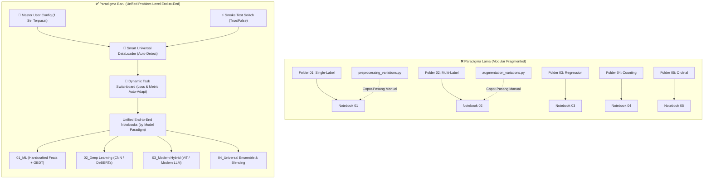

# 🏛️ UNIFIED COMPETITION FRAMEWORK GUIDE
## Paradigma Baru Kit Kompetisi Data Science & AI (GEMASTIK & Kaggle Standards)
### Dari Fragmentasi Modul Menuju Arsitektur Deklaratif End-to-End Berbasis Granularitas Output

---

## 📑 DAFTAR ISI
1. [Filosofi & Latar Belakang: Mengapa Paradigma Lama Gagal di Final 5 Jam](#1-filosofi--latar-belakang-mengapa-paradigma-lama-gagal-di-final-5-jam)
2. [Perbandingan Arsitektur: Fragmented Modules vs. Unified End-to-End](#2-perbandingan-arsitektur-fragmented-modules-vs-unified-end-to-end)
3. [Pilar Desain & Komponen Inti Kit Baru](#3-pilar-desain--komponen-inti-kit-baru)
   - [3.1 Master User Config (Single Source of Truth)](#31-master-user-config-single-source-of-truth)
   - [3.2 Smoke Test Mode (Fail-Safe Verifier 10 Detik)](#32-smoke-test-mode-fail-safe-verifier-10-detik)
   - [3.3 Smart Universal DataLoader (Auto-Detection Engine)](#33-smart-universal-dataloader-auto-detection-engine)
   - [3.4 Dynamic Task Routing (The Switchboard)](#34-dynamic-task-routing-the-switchboard)
   - [3.5 Strict Separation of Predictions (Raw vs Post-Processed)](#35-strict-separation-of-predictions-raw-vs-post-processed)
   - [3.6 Standalone EDA Decision Kit (Bukan Sekadar Grafik)](#36-standalone-eda-decision-kit-bukan-sekadar-grafik)
4. [Ironclad Rules & Standar Rekayasa (Clean-Code DS)](#4-ironclad-rules--standar-rekayasa-clean-code-ds)
5. [Studi Kasus Pembuktian di Computer Vision (Level A, B, C)](#5-studi-kasus-pembuktian-di-computer-vision-level-a-b-c)
6. [Blueprint & Panduan Transisi ke Konteks NLP (Natural Language Processing)](#6-blueprint--panduan-transisi-ke-konteks-nlp-natural-language-processing)
   - [6.1 Mengapa 12 Kasus Text Regression Harus Ditransformasi](#61-mengapa-12-kasus-text-regression-harus-ditransformasi)
   - [6.2 Taksonomi Granularitas NLP (Level A, B, C)](#62-taksonomi-granularitas-nlp-level-a-b-c)
   - [6.3 Desain Master User Config untuk NLP](#63-desain-master-user-config-untuk-nlp)
   - [6.4 Smart NLP DataLoader Architecture](#64-smart-nlp-dataloader-architecture)
   - [6.5 Dynamic NLP Task Switchboard (Loss & Metric Engine)](#65-dynamic-nlp-task-switchboard-loss--metric-engine)
   - [6.6 Textual EDA Decision Kit Matrix](#66-textual-eda-decision-kit-matrix)
   - [6.7 Rencana Aksi Migrasi Folder `text_regression/`](#67-rencana-aksi-migrasi-folder-text_regression)
7. [Protokol Eksekusi 5 Jam GEMASTIK (Cheat Sheet Hari-H)](#7-protokol-eksekusi-5-jam-gemastik-cheat-sheet-hari-h)

---

## 1. Filosofi & Latar Belakang: Mengapa Paradigma Lama Gagal di Final 5 Jam

Dalam persiapan kompetisi Data Science seperti GEMASTIK (babak final 5 jam offline) maupun hackathon Kaggle berdurasi pendek, **musuh nomor satu peserta bukanlah kekurangan algoritma, melainkan FRIKSI WAKTU dan KELELAHAN KOGNITIF (Cognitive Overload)**.

### ⚠️ Kegagalan Paradigma "Modular Fragmentation" (Banyak Folder & Skrip Copot-Pasang):
Pada arsitektur terdahulu, setiap sub-tipe masalah dibuatkan folder tersendiri (misal: di NLP ada 12 folder terpisah: `01_single_continuous_readability`, `02_multi_output_ell`, `06_ordinal_essay_scoring`, dst., atau di CV ada folder *single-label*, *multi-label*, *segmentation*, dll). Setiap folder memiliki skrip `preprocessing_variations.py`, `augmentation_variations.py`, dan notebook masing-masing.

Ketika bertanding di bawah tekanan waktu 5 jam:
1. **Navigasi Membingungkan (Friction):** Peserta menghabiskan 20–30 menit pertama hanya untuk mencari: *"Skrip mana yang cocok untuk kasus ini?"*, *"Apakah saya harus mengimpor fungsi dari folder 01 atau folder 06?"*.
2. **Broken Import & Signature Mismatches:** Memindahkan modul preprocessing dari satu folder ke folder lain sering menyebabkan `ImportError`, argumen fungsi tidak cocok, atau kesalahan nama kolom.
3. **Risiko Residu Kode Rusak (Copy-Paste Traps):** Saat menyalin kode dari klasifikasi ke regresi, potongan kode `softmax()` atau `loss = CrossEntropyLoss()` sering kali tertinggal secara tidak sengaja, merusak gradient update tanpa disadari selama berjam-jam.
4. **Kehabisan Waktu untuk Validasi:** Waktu yang seharusnya dipakai untuk menganalisis error data, tuning augmentasi, dan ensembling habis hanya untuk "menjahit" potongan-potongan file agar bisa berjalan tanpa error.

> [!IMPORTANT]
> **Prinsip Utama Paradigma Baru:**
> Jangan mengelompokkan kode berdasarkan **"Variasi Kasus Bisnis"**, melainkan kelompokkan berdasarkan **"Tingkat Granularitas Output Spasial / Sekuensial"**.
> 
> Citra untuk klasifikasi 2 kelas, 100 kelas, regresi skor kontinu, estimasi jumlah objek, maupun ordinal grading secara komputasi adalah **1 IDENTIK**:
> $$\text{Input Tensor} \longrightarrow \text{Backbone (Feature Extractor)} \longrightarrow \text{Linear Head} \longrightarrow \text{Output Target}$$
> Yang berubah hanyalah **dimensi layer terakhir, fungsi aktivasi, fungsi loss, dan metriknya**. Hal ini harus diurus oleh **sistem percabangan otomatis (Switchboard)**, bukan dengan memecahnya ke 10 notebook berbeda!

---

## 2. Perbandingan Arsitektur: Fragmented Modules vs. Unified End-to-End



### Tabel Komparasi Teknis

| Dimensi Parameter | ❌ Paradigma Lama (Banyak Folder Copot-Pasang) | ✅ Paradigma Baru (Unified End-to-End) |
| :--- | :--- | :--- |
| **Banyak File Notebook** | 20–40 notebook terpisah per kasus | **3–4 Notebook Universal** per domain |
| **Konfigurasi Pengguna** | Tersebar di puluhan sel kode bawah | **Hanya 1 Sel Terpusat di paling atas (Master Config)** |
| **Uji Coba Awal** | Harus melatih data penuh (berisiko error di fold 4) | **Smoke Test Toggle (10 detik fail-safe run)** |
| **Penanganan Data** | Hardcode nama kolom & path gambar/teks | **Smart Loader**: auto-detect CSV, ID, folder, format |
| **Adaptasi Target** | Ubah manual arsitektur model, loss, metrik | **Dynamic Routing**: ganti `TASK_TYPE`, model auto-tune |
| **Ketergantungan Eksternal** | Butuh impor modul `.py` dari direktori induk | **Self-Contained**: 100% jalan mandiri tanpa broken import |
| **Submission Output** | Sering tercampur prediksi probabilitas & label final | **Strict Separation**: `submission_raw` vs `postprocessed` |
| **Waktu Siap Tempur** | 45–60 menit setup awal | **< 3 Menit** langsung submit benchmark pertama |

---

## 3. Pilar Desain & Komponen Inti Kit Baru

Arsitektur baru dibangun di atas 6 komponen pondasi:

### 3.1 Master User Config (Single Source of Truth)
Seluruh parameter runtime dideklarasikan di satu sel paling atas notebook. Seluruh sel di bawahnya berjalan secara mutlak (*unconditional*) tanpa intervensi manual.

```python
# =============================================================================
# 🚨 MASTER USER CONFIGURATION (SATU-SATUNYA TEMPAT YANG PERLU DIEDIT)
# =============================================================================

# 1. Pipeline Verification Mode
# True  = Jalankan 10 detik (subsample minimal, 1 fold, 1 epoch) untuk verifikasi pipeline
# False = Jalankan Full 5-Fold Competition Training
SMOKE_TEST = True

# 2. Task Selector
# Opsi: 'single_label' | 'multi_label' | 'regression' | 'ordinal' | 'counting'
TASK_TYPE = 'single_label'

# 3. Model Architecture
MODEL_NAME = 'resnet18'      # Bebas: 'convnext_tiny', 'deberta-v3-base', dll
PRETRAINED = False           # True jika ada internet/bobot lokal, False untuk offline safety

# 4. Path Data & Direktori
TRAIN_CSV_PATH  = 'train.csv'
TEST_CSV_PATH   = 'test.csv'
IMAGE_DIR_TRAIN = 'train_images'
IMAGE_DIR_TEST  = 'test_images'

# 5. Identifier & Target Column Mapping
ID_COL       = 'id'
FILEPATH_COL = 'filepath'     # Kolom nama file (opsional, jika None auto match by ID)
TARGET_COLS  = ['label']      # List kolom target

# 6. Group Column (Mencegah Kebocoran)
GROUP_COL    = 'patient_id'   # 'author_id', 'camera_group', atau None jika independen

# 7. Hyperparameters
BATCH_SIZE    = 8 if SMOKE_TEST else 32
NUM_EPOCHS    = 1 if SMOKE_TEST else 10
LEARNING_RATE = 1e-4
N_SPLITS      = 2 if SMOKE_TEST else 5
SEED          = 42
```

---

### 3.2 Smoke Test Mode (Fail-Safe Verifier 10 Detik)
Dalam kompetisi 5 jam, salah satu bencana terbesar adalah menjalankan training 5-fold selama 40 menit, lalu program **CRASH pada detik terakhir di Fold 5** karena salah format kolom submission atau kehabisan memori (*OOM*).

> [!TIP]
> **Mekanisme Smoke Test:**
> Jika `SMOKE_TEST = True`:
> 1. Dataset dipotong otomatis menjadi 16–32 sampel.
> 2. Resolusi citra / panjang token dikurangi setengahnya.
> 3. Fold yang berjalan hanya 1 fold dengan 1 epoch.
> 4. Seluruh siklus dijalankan: *Load $\rightarrow$ Augment $\rightarrow$ Forward $\rightarrow$ Backward $\rightarrow$ OOF Predict $\rightarrow$ Test Predict $\rightarrow$ Postprocess $\rightarrow$ CSV Output $\rightarrow$ Sanity Check*.
>
> Seluruh eksekusi selesai dalam **10–15 detik**. Jika file `submission_*.csv` berhasil dibuat dan lolos pengecekan integritas, peserta memiliki kepastian 100% bahwa pipeline bebas bug dan siap diubah ke `SMOKE_TEST = False`.

---

### 3.3 Smart Universal DataLoader (Auto-Detection Engine)
Loader didesain untuk tidak pernah gagal membaca data kompetisi apa pun bentuknya:
1. **Kasus A (CSV dengan path lengkap):** Jika kolom `filepath` berisi path absolut atau relatif (`train_images/img_001.png`), loader langsung menggunakannya.
2. **Kasus B (CSV hanya berisi ID):** Jika CSV hanya punya kolom `id` (misal: `HD_5c038c7bda`), loader secara pintar menguji daftar ekstensi valid (`.jpg`, `.png`, `.jpeg`, dll) di dalam direktori gambar dan menemukan file aslinya.
3. **Kasus C (Folder-based dataset):** Jika tidak ada file CSV, loader otomatis merayapi struktur folder (`train/class_A/001.jpg`, `train/class_B/002.jpg`), menjadikan nama folder sebagai label target dan menghasilkan dataframe metadata secara otomatis.

---

### 3.4 Dynamic Task Routing (The Switchboard)
Komponen ini membaca string `TASK_TYPE` dari Master Config dan otomatis mengonfigurasi komponen internal model tanpa perlu menyentuh arsitektur neural network:

| Task Type | Dimensi Output (`out_dim`) | Activation Layer | Loss Function | Metric Evaluasi Utama |
| :--- | :--- | :--- | :--- | :--- |
| **`single_label`** | $C$ (Jumlah kelas unik) | `nn.Softmax(dim=1)` | `nn.CrossEntropyLoss()` | Macro F1 & Accuracy |
| **`multi_label`** | $K$ (Jumlah kolom target) | `nn.Sigmoid()` | `nn.BCEWithLogitsLoss()` | Mean Columnwise ROC-AUC |
| **`regression`** | $N$ (Jumlah target kontinu) | `nn.Identity()` | `nn.SmoothL1Loss(beta=1.0)` | RMSE & MAE |
| **`ordinal`** | 1 (Skalar peringkat) | `nn.Identity()` | `nn.SmoothL1Loss()` + Thresholding | Quadratic Weighted Kappa (QWK) |
| **`counting`** | $N$ (Jumlah target hitung) | `nn.ReLU()` (Non-negatif) | `nn.L1Loss()` / SmoothL1 | MAE & Normalized Count Error |

---

### 3.5 Strict Separation of Predictions (Raw vs Post-Processed)
Kekeliruan umum di kompetisi adalah langsung menyimpan prediksi yang telah dibulatkan (*hard labels*). Ini menghancurkan potensi ensembling.

Pipeline baru selalu menghasilkan 3 file artefak:
1. **`*_raw_test_predictions.npy`**: Matriks NumPy presisi tinggi (probabilitas kontinu untuk klasifikasi, nilai float tak dibulatkan untuk regresi/counting). File ini adalah input emas untuk `04_universal_ensemble_blending.ipynb`.
2. **`submission_*_raw.csv`**: File CSV berisi probabilitas mentah per kolom.
3. **`submission_*_postprocessed.csv`**: File CSV hasil kalibrasi post-processing (thresholding argmax, pembulatan integer non-negatif, clipping range, atau pengurutan RLE) yang **100% siap di-submit ke portal lomba**.

---

### 3.6 Standalone EDA Decision Kit (Bukan Sekadar Grafik)
EDA yang baik bukanlah membuat 20 plot warna-warni yang membuang waktu. Di kompetisi 5 jam, **setiap grafik harus langsung menghasilkan keputusan teknis pada pipeline pemodelan**.

Oleh karena itu, modul EDA dipisahkan menjadi skrip diagnostik Python mandiri (`eda_kit/`):
- Berjalan cepat dari terminal: `python 01_eda_resolution_and_aspect_ratio.py`.
- Disertai **Master Decision Matrix**:
  - *"Jika Aspect Ratio bervariasi ekstrem (> 2.0) $\rightarrow$ Gunakan Letterbox Padding, jangan Resize langsung."*
  - *"Jika rasio kelas terlangka < 10% $\rightarrow$ Aktifkan Class Weights di CrossEntropy atau gunakan Focal Loss."*
  - *"Jika Group ID terdeteksi tumpang tindih antara Train dan Test $\rightarrow$ Wajib gunakan GroupKFold, KFold biasa akan menyebabkan kebocoran fatal."*

---

## 4. Ironclad Rules & Standar Rekayasa (Clean-Code DS)

Seluruh notebook dan modul dalam kit ini tunduk pada aturan rekayasa absolut berikut:

> ### 🛑 Rule 1: ZERO `assert` Statement
> Dilarang menggunakan kata kunci `assert` di seluruh sel notebook dan skrip produksi.
> *Alasan:* `assert` melempar `AssertionError` yang mematikan eksekusi kernel Jupyter secara mendadak. Jika terjadi ketidakcocokan data saat live demo atau presentasi juri, sistem harus mencetak log diagnostik yang informatif (`print(f"[Warning] ...")`), bukan meledak dengan traceback merah.
>
> ### 🛑 Rule 2: ZERO Custom Library Wrappers
> Dilarang membuat class wrapper tebal di sekitar library primitif (misal: membuat class `MyUniversalTrainer` yang membungkus PyTorch).
> *Alasan:* Wrapper menyembunyikan parameter esensial, menyulitkan debugging saat runtime error, dan memperlambat eksperimentasi kilat. Panggil library standar langsung secara eksplisit (`torch.nn`, `timm`, `lightgbm`, `transformers`, `albumentations`).
>
> ### 🛑 Rule 3: Declarative Single-Cell Configuration
> Seluruh variabel yang boleh disunting pengguna WAJIB berada di Sel Master Config paling atas. Seluruh sel di bawahnya (DataLoader, Arsitektur, Training Loop, Submission) harus bersifat *generic & declarative* sehingga berjalan mulus tanpa perlu diedit satu baris pun.
>
> ### 🛑 Rule 4: Dynamic Feature Selection via `select_dtypes`
> Pada notebook berbasis Machine Learning (GBDT), dilarang melakukan hardcode daftar kolom numerik atau kategorikal. Gunakan seleksi dinamis:
> ```python
> NUMERICAL_COLS = train_df.select_dtypes(include=[np.number]).columns.tolist()
> FEATURE_COLS = [c for c in NUMERICAL_COLS if c not in EXCLUDE_COLS and c in test_df.columns]
> ```
>
> ### 🛑 Rule 5: Strict Anti-Leakage Protocol (`GroupKFold` Priority)
> Jika dataset memiliki kolom identifikasi entitas (misal: `patient_id`, `author_id`, `camera_serial`, `prompt_id`), pemisahan fold **WAJIB menggunakan `GroupKFold`**. Memisahkan data dengan `KFold` biasa ketika ada gambar/teks dari pasien yang sama di train dan val adalah penyebab nomor satu model overfitting parah di private leaderboard.
>
> ### 🛑 Rule 6: 100% Offline-Safe Resilience
> Di lokasi lomba GEMASTIK, koneksi internet sering kali diputus atau dibatasi (*isolated offline environment*).
> Seluruh kode tidak boleh bergantung pada unduhan otomatis bobot via internet yang menyebabkan hang. Model harus mendukung inisialisasi lokal atau arsitektur offline murni (seperti lightweight U-Net PyTorch murni atau konfigurasi arsitektur lokal).
>
> ### 🛑 Rule 7: Stored Output Mandate
> Setiap notebook `.ipynb` yang disimpan di repositori kit harus telah dieksekusi secara penuh via `nbconvert` sehingga grafik visualisasi, log epoch training, metrik validasi, dan verifikasi submission telah tersimpan rapi di dalam file JSON notebook.
>
> ### 🛑 Rule 8: Bahasa & Komunikasi
> Kode program, penamaan variabel, komentar kode, dan dokumentasi Markdown teknis di dalam notebook ditulis dalam bahasa **Inggris** (sesuai standar industri global). Diskusi taktis dan komunikasi dengan pengguna dilakukan dalam bahasa **Indonesia**.

---

## 5. Studi Kasus Pembuktian di Computer Vision (Level A, B, C)

Arsitektur ini telah diuji dan terbukti berhasil menangani tiga level granularitas Computer Vision:

### Level A: Level Gambar Utuh (Whole-Image Granularity)
Mencakup 7 kasus: *Single-Label, Multi-Label, Fine-Grained, Regression, Ordinal, Counting, Anomaly Detection*.
- **Tersedia 4 Notebook:**
  - [`01_ml_gbdt_universal.ipynb`](file:///c:/Users/yasse/OneDrive/Desktop/Mine%20All%20Ds/kitGemastikk/text_regression/computervision/level_a_gambar_utuh/notebooks/01_ml_gbdt_universal.ipynb): Ekstraksi 25+ fitur statistik warna, tekstur Gray-Level Co-occurrence Matrix (GLCM), dan Hu Moments $\rightarrow$ Multi-output LightGBM.
  - [`02_deep_learning_cnn_universal.ipynb`](file:///c:/Users/yasse/OneDrive/Desktop/Mine%20All%20Ds/kitGemastikk/text_regression/computervision/level_a_gambar_utuh/notebooks/02_deep_learning_cnn_universal.ipynb): PyTorch Timm CNN (ResNet18 / EfficientNet) dengan Mixed Precision (`torch.amp`).
  - [`03_vision_transformer_universal.ipynb`](file:///c:/Users/yasse/OneDrive/Desktop/Mine%20All%20Ds/kitGemastikk/text_regression/computervision/level_a_gambar_utuh/notebooks/03_vision_transformer_universal.ipynb): Modern ViT / ConvNeXt dengan AdamW dan Cosine Annealing Learning Rate.
  - [`04_universal_ensemble_blending.ipynb`](file:///c:/Users/yasse/OneDrive/Desktop/Mine%20All%20Ds/kitGemastikk/text_regression/computervision/level_a_gambar_utuh/notebooks/04_universal_ensemble_blending.ipynb): Menggabungkan prediksi OOF mentah dari GBDT, CNN, dan ViT menjadi satu prediksi ensemble yang superior.
- **Validasi Nyata:** Dataset nyata [`latian1/`](file:///c:/Users/yasse/OneDrive/Desktop/Mine%20All%20Ds/kitGemastikk/text_regression/computervision/latian1/) (*Hitung Duit: multi-class coin & bill counting*) langsung terdeteksi dan terproses 100% tanpa mengubah sel kode pemodelan!

### Level B: Level Wilayah (Region / Bounding Box Detection)
Mencakup 5 kasus: *Object Detection, Oriented Detection, Small Object (SAHI), OCR Box, Document Layout*.
- Modul [`bbox_converter.py`](file:///c:/Users/yasse/OneDrive/Desktop/Mine%20All%20Ds/kitGemastikk/text_regression/computervision/level_b_wilayah_detection/bbox_converter.py) mengonversi format bounding box tabel CSV (Pascal VOC `[xmin, ymin, xmax, ymax]` atau COCO `[xmin, ymin, w, h]`) langsung menjadi format normalisasi YOLO `[x_center, y_center, w, h]`, menyusun `data.yaml`, dan mengonversi hasil prediksi kembali ke format Kaggle `PredictionString`.
- Notebook [`01_universal_object_detection_yolo.ipynb`](file:///c:/Users/yasse/OneDrive/Desktop/Mine%20All%20Ds/kitGemastikk/text_regression/computervision/level_b_wilayah_detection/notebooks/01_universal_object_detection_yolo.ipynb) dapat dijalankan 100% offline.

### Level C: Level Piksel (Pixel / Segmentation)
Mencakup 10 kasus: *Semantic, Binary, Multi-Class, Instance, Panoptic, Medical 2D, Salient Matting, Change Detection, Referring, SAM*.
- Modul [`rle_mask_utils.py`](file:///c:/Users/yasse/OneDrive/Desktop/Mine%20All%20Ds/kitGemastikk/text_regression/computervision/level_c_piksel_segmentasi/rle_mask_utils.py) mengurus Run-Length Encoding standar *column-major* ('F') Kaggle, evaluasi Dice Score, dan IoU.
- Notebook [`01_universal_semantic_segmentation_unet.ipynb`](file:///c:/Users/yasse/OneDrive/Desktop/Mine%20All%20Ds/kitGemastikk/text_regression/computervision/level_c_piksel_segmentasi/notebooks/01_universal_semantic_segmentation_unet.ipynb) menggunakan PyTorch U-Net murni dan `ComboLoss` ($0.5\text{BCE} + 0.5\text{Dice}$) untuk menangani masalah ketidakseimbangan piksel latar belakang hingga 99%.

---

## 6. Blueprint & Panduan Transisi ke Konteks NLP (Natural Language Processing)

Sekarang, kita mengaplikasikan **seluruh filosofi arsitektur terpadu ini ke domain NLP**.

### 6.1 Mengapa 12 Kasus Text Regression Harus Ditransformasi
Di folder [`text_regression/`](file:///c:/Users/yasse/OneDrive/Desktop/Mine%20All%20Ds/kitGemastikk/text_regression/), saat ini terdapat 12 folder terpisah:
- `01_single_continuous_readability`
- `02_multi_output_ell`
- `03_prompt_conditioned_summary`
- `04_high_dimensional_qa`
- `05_pairwise_phrase_matching`
- `06_ordinal_essay_scoring`
- `07_multimodal_text_tabular`
- `08_bounded_fraction_toxicity`
- `09_count_engagement_popularity`
- `10_financial_sentiment_impact`
- `11_conversational_csat`
- `12_pairwise_preference_margin`

**Masalah di Hari-H Lomba:**
Jika lomba memberikan soal NLP, peserta akan panik mencocokkan soal ke salah satu dari 12 folder tersebut. Jika soalnya adalah *"Prediksi skor esai dari 1.0 sampai 6.0"*, apakah ini Kasus 01 (readability), Kasus 02 (ell), atau Kasus 06 (ordinal essay)? Jika peserta salah memilih folder, mereka harus menyalin ulang seluruh kode.

**Solusi Baru: Transisi ke 3 Level Granularitas NLP**:
Sama seperti Computer Vision yang dibagi menjadi Gambar Utuh, Kotak, dan Piksel, dalam NLP seluruh kasus terbagi menjadi **3 Tingkat Granularitas Output Teks**:

```mermaid
graph TD
    NLP["Tantangan NLP Kompetisi"] --> LA["Level A: Level Teks Utuh (Sequence Classification & Regression)"]
    NLP --> LB["Level B: Level Token / Rentang (Token Classification & Extraction)"]
    NLP --> LC["Level C: Level Teks Generatif (Sequence-to-Sequence & Generation)"]

    LA --> LA1["Single Continuous Score (Readability, Impact)"]
    LA --> LA2["Multi-Output Continuous (ELL English Language)"]
    LA --> LA3["Bounded Probability / Fraction (Toxicity 0-1)"]
    LA --> LA4["Ordinal Grading (Automated Essay Scoring, QWK)"]
    LA --> LA5["Counting / Volume (Word Engagement Count)"]
    LA --> LA6["Sentence Pair Similarity (Patent Matching, NLI)"]
    LA --> LA7["Multi-Class / Multi-Label Sentiment"]

    LB --> LB1["Named Entity Recognition (NER)"]
    LB --> LB2["Keyphrase & Term Extraction"]
    LB --> LB3["Question Answering Span (Start/End Token)"]

    LC --> LC1["Abstractive Summarization (ROUGE)"]
    LC --> LC2["Machine Translation (BLEU)"]
    LC --> LC3["Generative Question Answering"]
```



---

### 6.2 Taksonomi Granularitas NLP (Level A, B, C)

#### 🅰️ Level A: Level Teks / Pasangan Teks Utuh (Whole-Text Level)
> **Definisi:** Model menerima 1 teks (atau sepasang teks $A$ dan $B$) dan memprediksi **1 atau beberapa nilai skalar/vektor** untuk keseluruhan teks tersebut.
> 
> Seluruh **12 kasus `text_regression`** terdahulu masuk ke dalam **Level A**!
> Arsitekturnya identik:
> $$\text{Teks} \longrightarrow \text{Tokenizer} \longrightarrow \text{Backbone Transformer (DeBERTa / RoBERTa / GBDT TF-IDF)} \longrightarrow \text{Pooling (Mean / CLS)} \longrightarrow \text{Linear Head} \longrightarrow \text{Target Output}$$

#### 🅱️ Level B: Level Token / Rentang (Token / Span Level)
> **Definisi:** Model memprediksi label untuk **setiap token individual** dalam kalimat, atau memprediksi indeks rentang `[start_token, end_token]`.
> - **Contoh Kompetisi:** Kaggle Feedback Prize (Evaluating Student Writing - memisahkan Lead, Position, Claim), BioNLP NER, SQuAD Question Answering.
> - **Metrik:** Span-level Micro/Macro F1 (Seqeval), Character Exact Match (EM), Token F1.

#### 🅲️ Level C: Level Sekuens Generatif (Seq2Seq / Text Generation Level)
> **Definisi:** Model menerima teks input dan menghasilkan **teks baru sebagai output**.
> - **Contoh Kompetisi:** Kaggle CommonLit Prompt Summary Scoring, Machine Translation, Text Abstractive Summarization.
> - **Metrik:** ROUGE-1, ROUGE-2, ROUGE-L, BLEU, METEOR.

---

### 6.3 Desain Master User Config untuk NLP

Berikut adalah desain Master Config untuk Notebook Universal NLP:

```python
# =============================================================================
# 🚨 MASTER USER CONFIGURATION (NLP UNIVERSAL PIPELINE)
# =============================================================================

# 1. Pipeline Verification Mode
SMOKE_TEST = True          # True = 10 detik tes pipeline; False = Full 5-Fold Training

# 2. Task Selector
# Opsi:
# 'single_regression'  : 1 target kontinu (Readability, CSAT, PetFinder-style)
# 'multi_regression'   : Multi target kontinu (ELL proficiency, Cohesion, Syntax)
# 'bounded_regression' : Target proporsi 0.0 - 1.0 (Toxicity, Agreement Fraction)
# 'ordinal'            : Peringkat integer bertingkat (Essay Grade 1-6, QWK metric)
# 'counting'           : Prediksi jumlah non-negatif (Engagement count, mentions)
# 'pair_matching'      : Pasangan teks (Context + Query -> Similarity Score / Label)
# 'single_label'       : Klasifikasi multi-class (Sentiment, Topic)
# 'multi_label'        : Klasifikasi multi-hot atribut teks
TASK_TYPE = 'single_regression'

# 3. Model Architecture
# Model GBDT  : 'lightgbm'
# Model Neural: 'microsoft/deberta-v3-small' (fast), 'microsoft/deberta-v3-base', 'roberta-base'
MODEL_NAME = 'microsoft/deberta-v3-small'
PRETRAINED = True          # False jika offline murni, atau isi path folder lokal
POOLING_TYPE = 'mean'      # 'mean', 'cls', 'max', 'gem'

# 4. Input & File Paths
TRAIN_CSV_PATH  = 'train.csv'
TEST_CSV_PATH   = 'test.csv'
SAMPLE_SUB_PATH = 'sample_submission.csv'

# 5. Identifier & Text Columns Mapping
ID_COL       = 'id'
TEXT_COL     = 'full_text'  # Kolom teks utama
TEXT_PAIR_COL = None        # Kolom teks kedua (jika ada kasus pair matching / context)

# 6. Target Columns
TARGET_COLS  = ['score']    # List nama kolom target di train.csv

# 7. Grouping / Stratification Column
GROUP_COL    = 'prompt_id'  # Kolom grup untuk mencegah kebocoran (atau None)

# 8. Training Hyperparameters
MAX_TOKEN_LENGTH = 128 if SMOKE_TEST else 512
BATCH_SIZE       = 4 if SMOKE_TEST else 16
NUM_EPOCHS       = 1 if SMOKE_TEST else 4
LEARNING_RATE    = 2e-5
WEIGHT_DECAY     = 0.01
WARMUP_RATIO     = 0.1
N_SPLITS         = 2 if SMOKE_TEST else 5
SEED             = 42
MIXED_PRECISION  = True
GRAD_CLIP_NORM   = 1.0

# 9. Output Filenames
RAW_SUBMISSION_PATH  = 'submission_nlp_raw.csv'
POST_SUBMISSION_PATH = 'submission_nlp_postprocessed.csv'
RAW_PREDICTIONS_NPY  = 'nlp_raw_test_predictions.npy'
```

---

### 6.4 Smart NLP DataLoader Architecture

Smart DataLoader untuk NLP secara otomatis mengatasi kebiasaan variasi penamaan kolom teks di Kaggle/GEMASTIK:

```python
class SmartNLPDataLoader:
    """Mendeteksi kolom teks dan pasangan teks secara otomatis dari sinonim populer."""
    CANDIDATE_TEXT_COLS = ['full_text', 'text', 'excerpt', 'essay', 'document', 'content', 'sentence', 'premise']
    CANDIDATE_PAIR_COLS = ['prompt', 'context', 'query', 'hypothesis', 'target_text', 'anchor']
    
    @classmethod
    def resolve_columns(cls, df, explicit_text_col=None, explicit_pair_col=None):
        cols = df.columns.tolist()
        resolved_text = explicit_text_col
        if resolved_text is None or resolved_text not in cols:
            for cand in cls.CANDIDATE_TEXT_COLS:
                if cand in cols:
                    resolved_text = cand
                    break
                    
        resolved_pair = explicit_pair_col
        if resolved_pair is None or resolved_pair not in cols:
            for cand in cls.CANDIDATE_PAIR_COLS:
                if cand in cols and cand != resolved_text:
                    resolved_pair = cand
                    break
                    
        return resolved_text, resolved_pair
```

---

### 6.5 Dynamic NLP Task Switchboard (Loss & Metric Engine)

Switchboard NLP mengonfigurasi dimensi output dan fungsi loss secara mulus:

```python
class NLPTaskSpecification:
    def __init__(self, task_type, target_cols, train_df):
        self.task_type = task_type
        self.target_cols = target_cols
        self.num_targets = len(target_cols)
        
        if task_type in ['single_regression', 'multi_regression']:
            self.out_dim = len(target_cols)
            self.criterion = nn.SmoothL1Loss(beta=1.0) # Huber loss tahan outlier
            self.activation = nn.Identity()
            
        elif task_type == 'bounded_regression':
            self.out_dim = len(target_cols)
            self.criterion = nn.BCEWithLogitsLoss()    # Target dalam [0, 1]
            self.activation = nn.Sigmoid()
            
        elif task_type == 'ordinal':
            self.out_dim = 1
            self.criterion = nn.MSELoss()
            self.activation = nn.Identity()
            self.unique_grades = sorted(train_df[target_cols[0]].unique())
            
        elif task_type == 'counting':
            self.out_dim = len(target_cols)
            self.criterion = nn.L1Loss()
            self.activation = nn.ReLU()                # Hitungan tidak boleh negatif
            
        elif task_type == 'pair_matching':
            self.out_dim = len(target_cols)
            self.criterion = nn.BCEWithLogitsLoss()
            self.activation = nn.Sigmoid()
            
        elif task_type == 'single_label':
            unique_classes = sorted(train_df[target_cols[0]].unique())
            self.num_classes = len(unique_classes)
            self.label_mapping = {val: idx for idx, val in enumerate(unique_classes)}
            self.inverse_mapping = {idx: val for idx, val in enumerate(unique_classes)}
            self.out_dim = self.num_classes
            self.criterion = nn.CrossEntropyLoss()
            self.activation = nn.Softmax(dim=1)
```

---

### 6.6 Textual EDA Decision Kit Matrix

Sama seperti di CV, kita menyusun **EDA Kit Teks Mandiri** yang berpasangan dengan **Decision Matrix**:

| Skrip Diagnostik Teks | Masalah yang Dideteksi | Ambang Batas (Threshold) | Aksi Teknis pada Pipeline NLP |
| :--- | :--- | :--- | :--- |
| `01_eda_token_length_distribution.py` | Distribusi panjang token kalimat/dokumen. | > 5% teks melebihi 512 token. | Terapkan *Head + Tail Truncation* (misal: 128 token awal + 384 token akhir), atau gunakan sliding window. Jangan potong dari depan saja! |
| `02_eda_text_cleaning_artifacts.py` | Karakter HTML (`&amp;`, `<br>`), encoding aneh, emoji. | Ditemukan > 0.1% baris. | Jalankan `ftfy.fix_text()` dan strip tag HTML menggunakan BeautifulSoup sebelum masuk ke tokenizer. |
| `03_eda_target_distribution_and_qwk.py` | Distribusi nilai target (continuous skewness atau ordinal steps). | Target berupa integer 1–6 dengan metrik QWK. | Gunakan regresi kontinu saat melatih model neural, lalu gunakan algoritma optimasi Nelder-Mead pada OOF untuk mencari *threshold cut-points* diskrit. |
| `04_eda_group_prompt_leakage.py` | Kolom `prompt_id` atau `author_id` tumpang tindih. | Kolom grup ditemukan di train & test. | **WAJIB gunakan `GroupKFold`** pada kolom grup tersebut. KFold biasa akan menghasilkan skor CV palsu yang terlalu optimis. |
| `05_eda_oov_vocabulary_overlap.py` | Rasio kata di test set yang tidak pernah muncul di train set. | OOV Rate > 20%. | Hindari model GBDT berbasis TF-IDF murni; prioritaskan model Pretrained Subword Transformer (DeBERTa Byte-Pair Encoding) yang tahan kata baru. |

---

### 6.7 Hirarki Arsitektur Domain NLP Baru (`NLP-FULL KIT/`)

Struktur terpadu yang memisahkan tugas pemahaman (NLU) dan generasi (NLG) secara tajam:

```
NLP-FULL KIT/
│
├── 00_QUICK_START/                             (Triage Cepat, Audit Lingkungan & SOP 5 Jam)
│   ├── competition_triage.py
│   ├── verify_environment.py
│   └── SOP_5_JAM_GEMASTIK.md
│
├── 00_GENERAL_TEXT_EDA/                        (4 Notebook Diagnostik Teks Universal)
│   ├── 01_token_length_and_truncation.ipynb
│   ├── 02_vocabulary_and_oov_overlap.ipynb
│   ├── 03_text_noise_and_cleaning.ipynb
│   └── 04_group_leakage_and_duplicates.ipynb
│
├── 01_NLU/                                     (Natural Language Understanding)
│   ├── 01_text_classification/                 (Klasifikasi Sentimen & Topik - GBDT, Transformer, Ensemble)
│   ├── 02_text_regression/                     (Regresi Skor, Esai AES & QWK - GBDT, Transformer, Ensemble)
│   └── 03_token_classification_ner/            # (NER, Ekstraksi PII & Token Span Labeling)
│
├── 02_NLG/                                     (Natural Language Generation)
│   ├── 01_text_summarization/                  (Peringkasan Teks & Seq2Seq)
│   └── 02_machine_translation_and_rewriting/   (Translasi Bahasa & Style Transfer)
│
├── 03_OFFLINE_WEIGHTS/                         (Bobot Offline Lokal: DeBERTa & IndoBERT untuk GPU RTX 3050)
└── 04_LEGACY_CASES_ARCHIVE/                    (Arsip 12 Studi Kasus Referensi Historis)
```

---

## 7. Protokol Eksekusi 5 Jam GEMASTIK (Cheat Sheet Hari-H)

Gunakan tabel waktu ini sebagai panduan operasional saat bertanding:

```
[00:00 - 00:20] ── TAHAP 1: DIAGNOSA SOAL & IDENTIFIKASI GRANULARITAS
                   ├─ Baca soal kompetisi:
                   │  ├─ 1 Target per data? ──────────> Buka LEVEL A (Gambar Utuh / Teks Utuh)
                   │  ├─ Koordinat kotak / Span token?> Buka LEVEL B (Deteksi Kotak / NER Span)
                   │  └─ Masker piksel / Teks baru? ──> Buka LEVEL C (Segmentasi / Seq2Seq)
                   └─ Jalankan eda_kit/ untuk mengecek resolusi/panjang teks & Group Leakage.

[00:20 - 00:45] ── TAHAP 2: BENCHMARK SUBMISSION PERTAMA (LEADERBOARD ANCHOR)
                   ├─ Salin path train.csv, test.csv, dan folder gambar/teks ke Master Config.
                   ├─ Tentukan TASK_TYPE ('single_label', 'regression', 'counting', dll).
                   ├─ Jalankan SMOKE_TEST = True (Verifikasi 10 detik lulus format submission).
                   ├─ Ubah SMOKE_TEST = False, latih Fold 0.
                   └─ SUBMIT 'submission_*_postprocessed.csv' ke portal! (Skor awal aman).

[00:45 - 03:00] ── TAHAP 3: FULL 5-FOLD DEEP LEARNING / TRANSFORMER
                   ├─ Jalankan 02_deep_learning_cnn_universal atau 02_transformer_deberta.
                   ├─ Pastikan mixed precision (amp) aktif untuk kecepatan 3-5x lipat.
                   ├─ Simpan bobot checkpoint fold terbaik ke folder models/.
                   └─ Simpan raw test predictions (.npy).

[03:00 - 04:00] ── TAHAP 4: ARCHITECTURE DIVERSITY & SECOND MODEL
                   ├─ Jalankan 01_ml_gbdt (sangat cepat, 3-5 menit).
                   └─ Atau jalankan 03_vision_transformer / RoBERTa alternatif.

[04:00 - 04:35] ── TAHAP 5: UNIVERSAL ENSEMBLE BLENDING & POST-PROCESSING
                   ├─ Buka 04_universal_ensemble_blending.ipynb.
                   ├─ Muat file raw .npy dari model GBDT dan Deep Learning.
                   ├─ Lakukan pencarian bobot optimal di Out-Of-Fold (OOF).
                   ├─ Kalibrasi threshold probabilitas atau cut-points QWK.
                   └─ Generate final submission ensemble.

[04:35 - 05:00] ── TAHAP 6: FINAL INTEGRITY CHECK & DOKUMENTASI
                   ├─ Periksa baris: len(sub_df) == len(test_df)?
                   ├─ Periksa nilai: zero NaN, zero inf?
                   ├─ Pastikan kolom ID dan kolom Target identik dengan sample_submission.csv.
                   └─ Kunci file final dan siapkan slide presentasi teknis.
```

---

> [!NOTE]
> Panduan ini menjadi **kontrak rekayasa resmi (architectural blueprint)** untuk seluruh pengembangan kit kompetisi di repositori ini, baik pada modul Computer Vision yang sudah aktif maupun modul NLP yang akan ditata selanjutnya.

